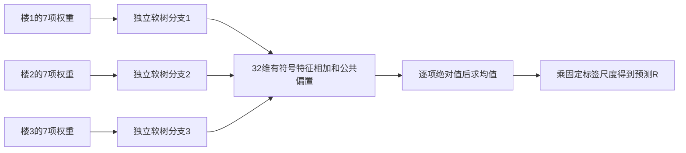

# 模型结构与寻优规则

## 为什么这样建模

控制器按每栋楼自己的7个权重对候选动作目标向量加权，并选取最小动作：

$$a^*=\arg\min_a w_b^\top q_a.$$

动作切换的比较边界为 $w_b^\top(q_a-q_c)=0$。权重整体缩放不改变决策，因此输入按楼归一化，再映射到6维Helmert正交坐标；零权重合法。

最终R对三楼合计净负荷的逐小时变化取绝对值，再对8周取平均。三楼有符号变化可以抵消，所以模型保留**分楼决策→有符号特征→跨楼相加→绝对值**的顺序。

每个分支4棵深度3的概率路由树，输出32维；三楼不共享可训练参数，共3692个参数：

$$\widehat R(W)=\frac{s}{32}\sum_k|c_k+\sum_b(F_{b,k}(w_b)-F_{b,k}(u))|.$$

$u$为均匀权重，$s$为原始2048行R的中位数。隐特征只受最终R监督，不解释为恢复出的真实小时物理状态。

软树的公开方法背景：[Frosst和Hinton，Distilling a Neural Network Into a Soft Decision Tree](https://research.google/pubs/distilling-a-neural-network-into-a-soft-decision-tree/)。本项目保留分楼与绝对值聚合这一结构约束，并没有使用该论文的蒸馏训练方式。

## 训练

- 固定种子2026–2030，float64；epoch分别486、484、484、481、471。
- AdamW，lr=0.001，wd=0.0001，batch=128。
- 固定尺度R的加权MSE + 0.02倍成对排序损失；至少一端为训练池低R前20%的样本，softplus温度0.1。
- v4初始五模型从原始2048行从头训练，线上行数0，不加载旧存档。每次反馈后，五种子从头初始化，用原始数据和本实验全部已返回反馈加权重训。
- 样本权重：来源加成（原始1、线上1.5）×低R加成[1,1.5]×搜索区域加成[1,1.5]，总上限3；保守裁剪只针对高R、远离好点且近重复的低价值原始点，原始记录永久保留。
- 不加载其他实验的新增标签、TabM模型或后续模型；最后50组反馈也进入v20训练，不提交第21次评估。

## 冻结v1探索阶段的候选

| 来源 | 名额 | 选择方式 |
|---|---:|---|
| 模型低值 | 10 | 原有全局提案 + 多起点投影Adam，mean与max各1000步，各选5个不同端点 |
| 单楼质量转移 | 20 | 小0.001α、中0.01α、粗0.08α、完整供体转移，四档各5个 |
| 楼宇重组 | 10 | 真实好点前64中，每楼收集至多8个不同向量，最多512种完整三楼组合 |
| 跨楼联合扰动 | 8 | 四个楼宇掩码(1,2)/(1,3)/(2,3)/(1,2,3)，每个掩码一对正负高斯扰动，std=0.04α，再投影 |
| 竞争区模型分歧 | 2 | 候选均值≤全池最低均值+epsilon时，才按五模型分歧挑选 |

质量转移在一楼内从供体拿走δ并加到受体，保持非负与和为1。前三档排除只能产生极小移动的供体，防止粗档名额被微小扰动占据。完整转移用于改变零坐标的支持集合。

搜索中心为当前已知真实最优点，加最多两个R≤最优+epsilon且L2距离≥0.15的不同好点。四档分别分配3/1/1个中心名额；不足三个中心时名额归还最优中心。最优中心每档包含一个固定轮转方向，不经过模型排序，另外8个联合探针也不经过模型筛选。

重组按**完整三楼组合**的预测R排序，不能分别计算每楼的非负R后相加。模型分歧是启发式风险指标，不是经过校准的置信区间。

初始α=1，范围[0.5,4]。连续两轮改善<0.02，或当轮按8位小数去重的R比例<70%，则翻倍；连续两轮改善≥0.02则乘0.7，扩张优先。重复分数只作为启发式，不证明动作轨迹完全相同。

epsilon=5.702176040780038，来自仅原始2048行的外层OOF五模型均值在真实低R前10%区域的MAE。核验了五折划分、25个检查点与全部2048行的未参与训练预测；这个阈值不是用本实验反馈拟合的。

各候选按楼归一化后，以12位小数哈希与全部已知点、同批次去重。来源不足时按粗转移→楼宇重组→联合扰动补齐，记录实际来源，不退回无竞争性的最远随机点。因此名额是正常目标，实际来源不足时的结构化补齐也会记录。

## v3：停滞后才精修

至少500组本实验反馈，且连续两轮最好真实R改善<0.02，下一轮进入精修。精修后固定50名额：模型低值4、四档转移各3共12、重组6、联合扰动8、方向扫描20。

扫描从本实验真实最好点出发，优先近期真实改善方向与两个轮转方向。每方向多步长0.0005/0.002/0.008/0.03/0.08；截断、去重，不足则增加合法方向和最大间隔二分补点。所有新点需要新真实评分，不能插值R。

局部距搜索中心≤0.2的点，以五模型 `R(c)+p_m(q)-p_m(c)` 去偏，用其均值+0.5标准差排序。启用之前先作影子记录；最近3个有效批次至少30个局部点、MAE下降≥20%、预测前5组选点的平均遗憾值不劣于原方法，下一轮才可启用；后续不满足则关闭。该门槛只用评分前预测和已返回真实R，不使用未来标签。

历史v3第16轮触发，第17–20轮精修并启用去偏。第17轮扫描先将R推进至104.386573，第18轮质量转移达到104.140308。没有消融实验将扫描和去偏的贡献单独分离，因此只报告整套策略的单次改善。

## v4新增：批次的信息价值分配

v4保持模型、五种子、损失及全量加权重训不变。每批的冲分/学习配额依次为30/20、35/15、40/10、50/0，对应1–6、7–14、15–19、20轮。学习点通过成对差值分歧、真实变化区间中点、局部竞争性分歧选择；新点都需真实评估，不能把插值当标签。角色不增加训练权重。第4/8/12/16轮后的单种子排除组实验仅用于诊断，不参与寻优。本文前述精修/去偏是保留的条件策略，本次v4没有触发。

## v4.0.2运行设置

本补丁仅收紧计算和随机数控制，不重新定义模型结构、损失、五种子、训练轮数、候选配额或真实评估预算。默认CPU、float64、单线程，优化器固定普通逐张量实现，关闭可选路径优化。相对旧GPU运行仍可能有数值差异；历史成绩与模型保留原样，详见复现说明。
